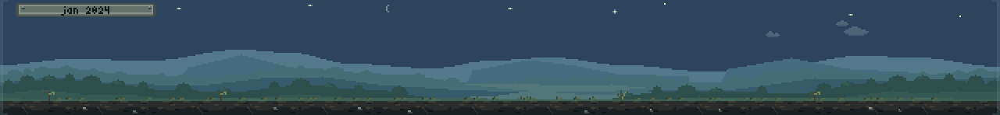

<p align="center">
  
</p>

# Repo Terrarium

A small pixel-art terrarium for the edge of your second monitor. It grows from a git repository
on your computer: test coverage is its light, code health is its soil, your commits are its rain,
and your tests or CI are its weather. Keep the code healthy and the commits coming and it grows
lush. Leave it alone for a month and it goes dormant behind fogged glass, and when the tests
fail, a storm rolls in.

Repo Terrarium only reads your repository and never changes anything in it. Nothing leaves your
computer unless you connect GitHub Actions for CI weather, and there are no accounts or
telemetry.

## Install

Repo Terrarium runs on Macs with Apple silicon (macOS 13 or later) and on 64-bit Windows 10 and
11. Download the DMG or the Windows installer from the
[Releases](https://github.com/FairCat-GD/repo-terrarium/releases) page. The builds aren't signed
yet, so the first launch needs one extra step, which the
[user guide](docs/USER-GUIDE.md#installing) walks through.

## Build from source

You'll need [Rust](https://rustup.rs); the right toolchain installs itself.

```sh
cargo run -p terrarium-app -- --repo <path>   # connect a repository and run the strip
cargo run -p terrarium-app -- --demo          # the strip through its sample looks
```

`cargo xtask verify` runs all the checks, and [xtask/README.md](xtask/README.md) describes the
other development tasks.

## More

- [User guide](docs/USER-GUIDE.md): connecting a repository, reading the terrarium, settings
  and privacy.
- [Architecture](docs/ARCHITECTURE.md): how it's built.
- [Changelog](CHANGELOG.md).

## License

The code is MIT or Apache-2.0, at your option (`LICENSE-MIT`, `LICENSE-APACHE`). The art is by
Svyat Marutyak under CC BY-SA 4.0 (`LICENSE-ART.md`), and the bitmap fonts are public domain.
